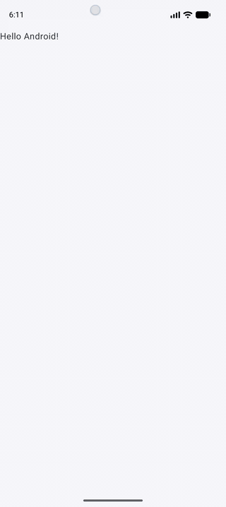

# QuickMenu

QuickMenu shows a debug menu in a bottom sheet over the screen you are looking at. Open it from
the action of an ongoing notification while the app is running.



- **The Activity under the menu stays `RESUMED`.** The sheet is added to the current Activity's
  window instead of starting another Activity. Use it to debug screens whose behavior changes in
  `onPause` / `onStop` (players, cameras, sensors, ...).
- **No setup code.** QuickMenu starts itself with
  [App Startup](https://developer.android.com/topic/libraries/app-startup), so you only add the
  dependency.
- **Pluggable items.** Every module can add its own menu items through Hilt.

# Quick Start

Add the maven repository as described in the [root README](../../../README.md#quick-start), then add
the dependency. QuickMenu uses Hilt, so your app must be annotated with `@HiltAndroidApp`.

```gradle
dependencies {
    debugImplementation("com.mokelab.android.devportal:quickmenu-core:$version")

    // hilt
    implementation(libs.hilt.android)
    ksp(libs.hilt.compiler)
}
```

## Notification permission

On Android 13 and later, QuickMenu needs the `POST_NOTIFICATIONS` permission. The library declares
it in its manifest but **never requests it**. Grant it yourself, for example with adb:

```sh
adb shell pm grant <your.application.id> android.permission.POST_NOTIFICATIONS
```

You can also grant it from the system settings, or from your app's own permission request. Without
the permission, QuickMenu only logs a warning (tag `QuickMenu`).

## Opening the menu

1. Pull down the notification shade and tap **Open menu** on the QuickMenu notification.
2. Close the notification shade. The menu is already open on the current screen.

The notification shade does not close by itself. Android does not close it when a notification
action is handled without starting an Activity.

# Adding menu items

Add `quickmenu-api` to the module that provides the items. Compose, Hilt and KSP are required.

```gradle
dependencies {
    implementation("com.mokelab.android.devportal:quickmenu-api:$version")

    // hilt
    implementation(libs.hilt.android)
    ksp(libs.hilt.compiler)
}
```

Implement `QuickMenuItem` and provide it with `@IntoSet` in a Hilt module installed in
`SingletonComponent`. Items are shown in a list in ascending order of `priority`.

```kotlin
private val toastItem = object : QuickMenuItem {
    override val priority = 0

    @Composable
    override fun Content(scope: QuickMenuScope) {
        TextButton(
            onClick = {
                Toast.makeText(scope.activity, "Hello", Toast.LENGTH_SHORT).show()
                scope.dismiss()
            },
        ) { Text("Show toast and close") }
    }
}

@Module
@InstallIn(SingletonComponent::class)
object MyQuickMenuModule {
    @Provides
    @IntoSet
    fun provideToastItem(): QuickMenuItem = toastItem
}
```

`QuickMenuScope` gives each item:

| Member     | Description                                                  |
|------------|--------------------------------------------------------------|
| `activity` | The `ComponentActivity` under the menu. It stays `RESUMED`.  |
| `dismiss()`| Closes the menu.                                             |

Each item renders one row of the menu, so it can be a button, a switch, a dropdown and so on. The
menu has no navigation. Put features that need their own screens into
[DevPortal](../../../README.md) and add an item that opens `DevPortalActivity`.

See [`DemoQuickMenuModule.kt`](../../../demo/src/debug/java/com/mokelab/android/devportal/DemoQuickMenuModule.kt)
for more examples.

# Limitations

- Only `ComponentActivity` (including `AppCompatActivity` and `FragmentActivity`) is supported.
  On other Activities, QuickMenu logs a warning and does nothing.
- Hilt is required (`@HiltAndroidApp`).
- The menu closes when the Activity is recreated, for example on rotation.

# Disabling auto start

To stop QuickMenu from starting automatically, remove its initializer in your app's manifest:

```xml
<provider
    android:name="androidx.startup.InitializationProvider"
    android:authorities="${applicationId}.androidx-startup"
    android:exported="false"
    tools:node="merge">
    <meta-data
        android:name="com.mokelab.android.devportal.quickmenu.core.QuickMenuInitializer"
        tools:node="remove" />
</provider>
```

You can then start it yourself whenever you like:

```kotlin
AppInitializer.getInstance(context).initializeComponent(QuickMenuInitializer::class.java)
```
